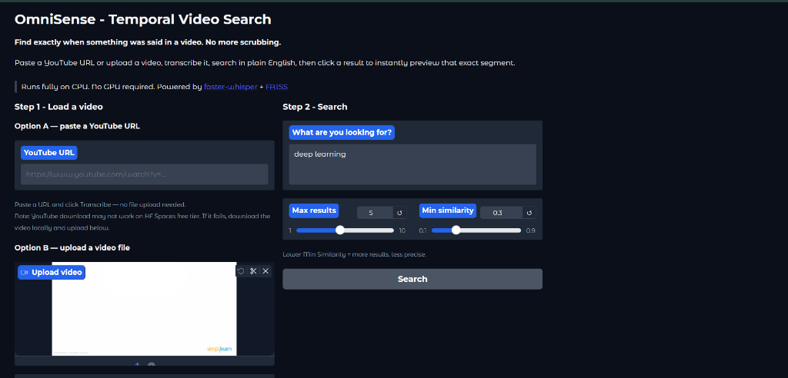
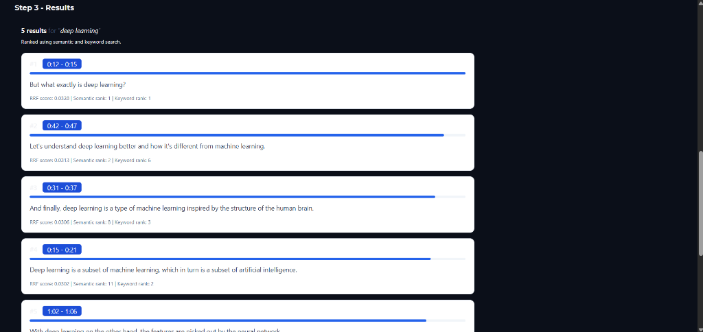
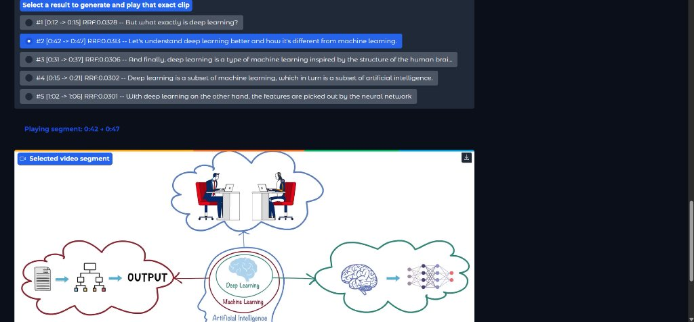

# OmniSense — Hybrid Temporal Video Search

**Find exactly when something was said in a video using natural-language and keyword search.**

[](https://omnisense-59wm.onrender.com/)
[](https://www.python.org/)
[](https://gradio.app/)
[](LICENSE)

[🌐 **Live Demo: OmniSense 2.0**](https://omnisense-59wm.onrender.com/)

OmniSense is an AI-powered video search application that transcribes video content, indexes transcript segments, and retrieves relevant moments using a combination of semantic search and keyword matching.

Instead of manually searching through an entire video, users can enter a natural-language query and find relevant moments with timestamps. Selecting a search result generates and plays the corresponding video clip.

**Upload a video or paste a YouTube URL → Transcribe → Search → Retrieve relevant moments → Play video clips.**

---

## Screenshots

### 1. Main Application Interface
Upload a video file or enter a YouTube URL, configure transcription settings, and input queries.


### 2. Hybrid Search Results
View ranked transcript segments retrieved through Reciprocal Rank Fusion (RRF), displaying timestamps, RRF scores, and individual semantic and BM25 ranks.


### 3. Timestamp-Based Video Playback
Select any search result to extract and play that exact video segment on demand without scrubbing through the full timeline.


---

## Key Features

- **Video transcription:** Convert video audio into timestamped transcript segments using `faster-whisper`.
- **Semantic search:** Retrieve relevant moments based on query meaning, even when exact words differ.
- **Keyword search:** Use BM25 to identify transcript segments containing relevant terms.
- **Hybrid ranking:** Combine semantic and keyword rankings using Reciprocal Rank Fusion (RRF).
- **Timestamp-based playback:** Select a search result to extract and play the corresponding video segment.
- **Multiple video inputs:** Support YouTube URLs and direct video uploads.
- **Search result details:** Display timestamps, RRF scores, and semantic and keyword ranks.

---

## Live Demo

- **Application URL:** [https://omnisense-59wm.onrender.com](https://omnisense-59wm.onrender.com)
- **Deployment Platform:** Render

> **Note:** YouTube downloads may occasionally be restricted by YouTube's anti-bot verification. Direct video upload is an alternative when URL downloading is unavailable. Application performance depends on available server resources and video size.

---

## How It Works

Suppose you remember that a speaker explained deep learning but cannot remember the exact timestamp.

Search for:

> *What exactly is deep learning?*

OmniSense retrieves relevant transcript segments using two retrieval methods:

1. **Semantic search** finds segments with similar meanings.
2. **BM25 keyword search** identifies segments containing matching terms.
3. **Reciprocal Rank Fusion** combines the rankings.
4. The application displays ranked search results.
5. Selecting a result generates and plays the corresponding video clip.

### Example Search Results

*The following illustrates the interface; the scores and results are illustrative, not measured benchmark results.*

| Rank | Timestamp | Transcript |
|:---:|:---:|---|
| **#1** | 00:12–00:15 | But, what exactly is deep learning? |
| **#2** | 00:42–00:47 | Let's understand deep learning better and how it's different from machine learning. |
| **#3** | 00:15–00:21 | Deep learning is a subset of machine learning, which in turn is a subset of artificial intelligence. |

### Why Hybrid Search?

Semantic search helps understand intent and paraphrases, while keyword search helps retrieve exact technical terminology, names, and phrases.

Combining their rankings can improve retrieval across both types of queries.

---

## Architecture

```text
       YouTube URL / Video Upload
                   |
                   v
           Audio Extraction
                FFmpeg
                   |
                   v
             Transcription
             faster-whisper
                   |
                   v
        Timestamped Transcript Chunks
                   |
           +-------+-------+
           |               |
           v               v
     Semantic Search   Keyword Search
      MiniLM + FAISS        BM25
           |               |
           +-------+-------+
                   |
                   v
        Reciprocal Rank Fusion
                   |
                   v
         Ranked Search Results
                   |
                   v
               Gradio UI
                   |
                   v
        Select Result and Extract
         Timestamped Video Clip
                   |
                   v
             Video Playback
```

---

## Technology Stack

| Category | Technologies |
|---|---|
| Programming language | Python |
| User interface | Gradio |
| Speech transcription | faster-whisper |
| Semantic embeddings | Sentence Transformers / MiniLM |
| Semantic retrieval | FAISS |
| Keyword retrieval | BM25 (`rank-bm25`) |
| Hybrid ranking | Reciprocal Rank Fusion (RRF) |
| Video and audio processing | FFmpeg |
| YouTube downloading | yt-dlp |
| Testing | pytest |
| Version control | Git and GitHub |
| Deployment | Render |

---

## Installation and Setup

### Prerequisites

- **Python 3.11.11**
- **Git**
- **FFmpeg** installed and accessible from the terminal

### 1. Clone the Repository

```bash
git clone https://github.com/Tmmfaris/omnisense.git
cd omnisense
```

The `main` branch contains the latest merged project.

### 2. Create a Virtual Environment

**Windows — PowerShell:**

```powershell
python -m venv .venv
.\.venv\Scripts\Activate.ps1
```

**Linux / macOS:**

```bash
python -m venv .venv
source .venv/bin/activate
```

### 3. Install Dependencies

```bash
python -m pip install -r requirements.txt
```

### 4. Install FFmpeg

Install FFmpeg for your operating system and make sure it is accessible from your terminal:

- **Windows:** `winget install Gyan.FFmpeg` (or download from [gyan.dev](https://www.gyan.dev/ffmpeg/builds/) and add `bin` to PATH)
- **Linux (Ubuntu/Debian):** `sudo apt update && sudo apt install -y ffmpeg`
- **macOS:** `brew install ffmpeg`

Verify the installation:

```bash
ffmpeg -version
```

### 5. Launch the Application

Run the application from the repository root with the virtual environment activated:

```bash
python -m omnisense.app
```

Open the local Gradio interface:

`http://127.0.0.1:7860`

---

## Hybrid Search Implementation

The hybrid search pipeline combines semantic and keyword rankings.

### Semantic Retrieval

The semantic search pipeline uses text embeddings and FAISS to retrieve transcript segments based on similarity in meaning.

### Keyword Retrieval

BM25 scores transcript segments based on query-term relevance. This helps retrieve exact technical terminology and distinctive phrases.

### Reciprocal Rank Fusion

The two rankings are combined using:

$$
\operatorname{RRF}(d) = \sum_{r \in R(d)} \frac{1}{k + r}
$$

Where:
- $d$ is a transcript segment.
- $R(d)$ contains the ranks assigned to the segment by the retrieval methods.
- $r$ is the rank of the segment in a retrieval list.
- $k$ is a constant used to reduce the influence of higher ranks (default $k = 60$).

The combined score is used to order the results.

> **Important:** An RRF score is not a probability or a percentage confidence score.

---

## Evaluation

OmniSense includes a preliminary evaluation script to compare semantic-only retrieval with hybrid retrieval using manually labelled relevant transcript segments.

Run the evaluation from the repository root:

```bash
python -m evaluation.evaluate_search
```

### Preliminary Results

| Metric | Semantic Search | Hybrid Search |
|---|:---:|:---:|
| Precision@5 | 0.320 | 0.320 |
| Recall@5 | 0.600 | 0.600 |
| MRR@5 | 0.900 | **1.000** |

**Interpretation:** In the current five-query benchmark, hybrid search achieves a higher MRR@5, while Precision@5 and Recall@5 are equal for both methods.

**Limitations:** These results are preliminary because the benchmark contains only five queries and uses manually assigned relevance labels. A larger, more diverse benchmark is needed to draw stronger conclusions about retrieval performance.

---

## Project Structure

```text
omnisense/
├── assets/
│   ├── 01_main_interface.png
│   ├── 02_search_results.png
│   └── 03_video_playback.jpg
├── omnisense/
│   ├── pipelines/
│   │   ├── audio.py
│   │   ├── search.py
│   │   └── hybrid_search.py
│   ├── utils/
│   │   ├── download.py
│   │   └── logger.py
│   ├── app.py
│   └── config.py
├── tests/
│   ├── test_search.py
│   └── test_hybrid_search.py
├── evaluation/
│   ├── benchmark.json
│   ├── evaluate_search.py
│   └── transcript_chunks.json
├── requirements.txt
├── .python-version
├── .gitignore
└── README.md
```

---

## Running Tests

Run the test suite from the repository root with your virtual environment activated:

```bash
python -m pytest tests/ -v
```

The tests cover the existing semantic search pipeline and hybrid search functionality.

---

## Potential Future Improvements

- Evaluate semantic-only, BM25-only, and hybrid retrieval on a larger labelled query dataset.
- Measure Recall@K, Precision@K, and Mean Reciprocal Rank (MRR).
- Add configurable search weights and ranking parameters.
- Improve multilingual transcript search.
- Cache transcript indexes to avoid rebuilding them unnecessarily.
- Add automated evaluation for query relevance and timestamp accuracy.
- Improve deployment scalability and resource management.

*These are planned improvements, not claims about features already implemented.*

---

## Author

**Muhammed Faris**

- GitHub: [@Tmmfaris](https://github.com/Tmmfaris)
- Project Repository: [https://github.com/Tmmfaris/omnisense](https://github.com/Tmmfaris/omnisense)
- Live Application: [https://omnisense-59wm.onrender.com](https://omnisense-59wm.onrender.com)

---

*OmniSense 2.0 — Search video content by meaning and find the moment that matters.*
